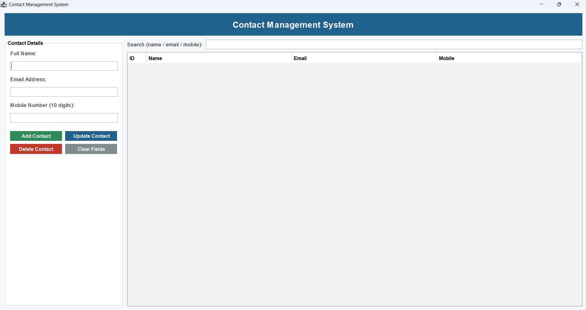
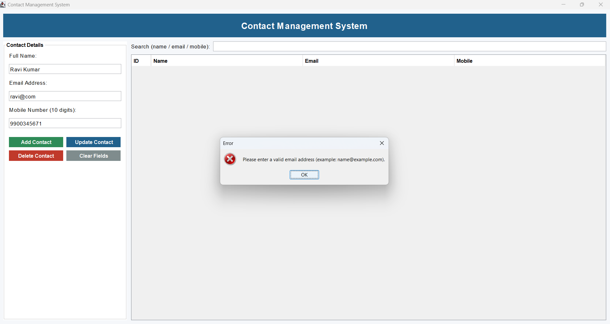
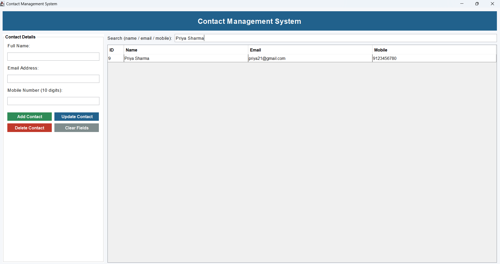

# Contact Management System

A simple desktop **Contact Management App** built with **Java Swing**, **SQLite** and **JDBC**.
It lets you add, view, search, update and delete contacts, with input validation and
permanent storage in a local database.

> CodeNova Java Programming Internship – **Task 1: Contact Management App**

---

## Project Objectives

- Build a working GUI application using Java Swing.
- Store data permanently using SQLite through JDBC.
- Apply OOP concepts: classes, objects, encapsulation and separation of responsibilities.
- Use the Java Collections Framework (`ArrayList`) to manage contact objects.
- Validate user input and handle errors without crashing.

## Features

| Feature | Description |
|---|---|
| Add Contact | Enter full name, email and mobile number, validated and saved to the database |
| View Contacts | All contacts are shown in a table (ID, Name, Email, Mobile) and load automatically on start-up |
| Search Contacts | Type in the search box to filter by name, email or mobile number (live search) |
| Update Contact | Click a row, its details appear in the fields; edit and press **Update Contact** |
| Delete Contact | Click a row, press **Delete Contact**, confirm in the dialog |
| Clear Fields | Empties the inputs and search box and shows all contacts again |

### Input validation
- Name must not be empty.
- Email must be in a valid format (e.g. `name@example.com`).
- Mobile number must be exactly 10 digits.
- Duplicate email addresses are not allowed.
- Duplicate mobile numbers are not allowed.
- All errors are shown with clear `JOptionPane` messages.

## Technologies Used

- **Java** (JDK 8 or newer)
- **Java Swing** – graphical user interface
- **SQLite** – lightweight file-based database
- **JDBC** with **PreparedStatement** – database access (prevents SQL injection)
- **Java Collections Framework** – `ArrayList<Contact>`
- **sqlite-jdbc** driver by Xerial (free, open source)

## Project Structure

```
ContactManagementApp/
├── src/
│   ├── Main.java                  # Entry point: sets up DB and opens the window
│   ├── Contact.java               # Model class (id, name, email, mobile)
│   ├── DatabaseConnection.java    # SQLite connection + table creation
│   ├── ContactDAO.java            # Add / view / search / update / delete queries
│   └── ContactManagementGUI.java  # Swing window, buttons, table, validation
├── lib/
│   └── sqlite-jdbc.jar            # SQLite JDBC driver (download – see below)
├── screenshots/                   # Add your screenshots here
├── .gitignore
└── README.md
```

## Database Information

- Database file: `contacts.db` (created automatically in the folder you run the app from).
- The table is created automatically on first run:

```sql
CREATE TABLE IF NOT EXISTS contacts (
    id     INTEGER PRIMARY KEY AUTOINCREMENT,
    name   TEXT NOT NULL,
    email  TEXT NOT NULL UNIQUE,
    mobile TEXT NOT NULL UNIQUE
);
```

- No manual database setup is needed. No passwords or secrets are used.
- `contacts.db` is listed in `.gitignore` so personal test data is not uploaded.

## Installing Dependencies

1. Install **JDK 8 or newer** (free: [Eclipse Temurin](https://adoptium.net/)). Check with `java -version`.
2. Download the **SQLite JDBC driver** from Maven Central:
   <https://repo1.maven.org/maven2/org/xerial/sqlite-jdbc/>
   Open the newest version folder and download `sqlite-jdbc-<version>.jar`
   (not the `-sources` or `-javadoc` file).
3. Put it in the `lib/` folder and rename it to `sqlite-jdbc.jar`.

## How to Run

### Option A – IntelliJ IDEA (Community Edition is free)
1. **File → Open** and choose the `ContactManagementApp` folder.
2. Right-click the `src` folder → **Mark Directory as → Sources Root** (if it isn't already).
3. **File → Project Structure → Project**: choose your JDK.
4. **File → Project Structure → Modules → Dependencies → + → JARs or Directories** → select `lib/sqlite-jdbc.jar` → OK.
5. Open `Main.java` and click the green ▶ Run button.

### Option B – Eclipse
1. **File → New → Java Project**, name it `ContactManagementApp`, untick *Create module-info.java*.
2. Copy the five `.java` files into the project's `src` folder (default package) and the JAR into a `lib` folder.
3. Right-click the project → **Build Path → Configure Build Path → Libraries → Classpath → Add JARs…** → choose `lib/sqlite-jdbc.jar`.
4. Right-click `Main.java` → **Run As → Java Application**.

### Option C – Command line
From inside the `ContactManagementApp` folder:

**Windows**
```bat
javac -d out src\*.java
java -cp "out;lib\sqlite-jdbc.jar" Main
```

**macOS / Linux**
```bash
javac -d out src/*.java
java -cp "out:lib/sqlite-jdbc.jar" Main
```

> If you see *"No suitable driver found"*, the JAR is not on the classpath – repeat the dependency step.

## How to Test Every Feature

| # | Test | Steps | Expected result |
|---|---|---|---|
| 1 | Add | Name `Ravi Kumar`, email `ravi@gmail.com`, mobile `9876543210` → **Add Contact** | Success message; row appears in table |
| 2 | View | Add 2–3 more contacts | All appear with auto-generated IDs |
| 3 | Search by name | Type `ravi` in search box | Only matching rows shown |
| 4 | Search by email | Type `gmail` | Contacts with that email shown |
| 5 | Search by mobile | Type `98765` | Contacts with those digits shown |
| 6 | Update | Click a row → change name → **Update Contact** | Table shows the new name |
| 7 | Delete | Click a row → **Delete Contact** → **Yes** | Row disappears (choosing **No** keeps it) |
| 8 | Empty field | Leave name empty → **Add Contact** | "Name cannot be empty." |
| 9 | Invalid email | Email `ravi@com` or `ravi.gmail.com` | "Please enter a valid email address…" |
| 10 | Short / long mobile | `12345` or `12345678901` or `98765abcde` | "Mobile number must contain exactly 10 digits…" |
| 11 | Duplicate email | Add a new contact with an existing email | "This email address is already saved…" |
| 12 | Duplicate mobile | Add a new contact with an existing mobile | "This mobile number is already saved…" |
| 13 | Update / Delete without selection | Press **Clear Fields**, then **Update** or **Delete** | "Please select a contact…" |
| 14 | Clear Fields | Press **Clear Fields** | Inputs and search box empty; all contacts shown |
| 15 | Persistence | Close the app and run it again | All saved contacts are still there |

## Screenshots

Add screenshots of the running app to the `screenshots/` folder and they will appear here:





**Suggested screenshots:** main window with contacts, a validation error, search results, and the delete confirmation dialog.

**Demo video (optional):** record your screen with a free tool such as OBS Studio, the Windows Game Bar (`Win + G`) or the macOS screenshot toolbar (`Cmd + Shift + 5`). Show: add → search → update → delete → a few validation errors → close and reopen the app to prove data is saved. Upload it to YouTube (unlisted) or Google Drive and paste the link here.

## Uploading to GitHub

1. Create a free account at <https://github.com> and click **New repository**.
   Name it `ContactManagementApp`, set it to **Public**, and do **not** add a README (you already have one).
2. Install Git (<https://git-scm.com>), then open a terminal in the project folder:

```bash
git init
git add .
git commit -m "Contact Management App - CodeNova Internship Task 1"
git branch -M main
git remote add origin https://github.com/<your-username>/ContactManagementApp.git
git push -u origin main
```

3. Refresh the GitHub page – your code, README and screenshots should be visible.
4. Submit the repository link.

> The `lib/sqlite-jdbc.jar` file is small and free to redistribute, so it can be committed so evaluators can run the project immediately.

## Author

*Vaishnavi K* – CodeNova Java Programming Intern

## Demo Video
[Watch the demo](
https://drive.google.com/file/d/1iPOhe1pyzBOnmzF126V4SoCOSp0pTDv5/view?usp=sharing)
